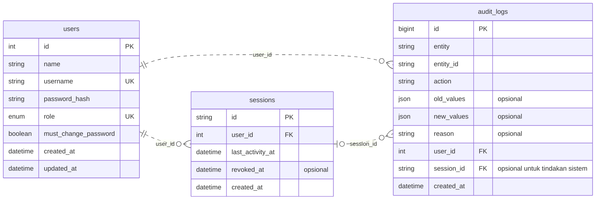
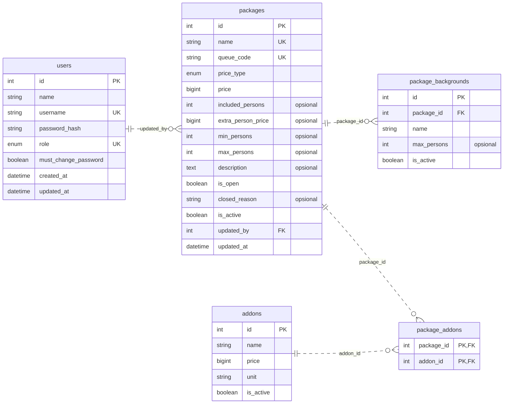
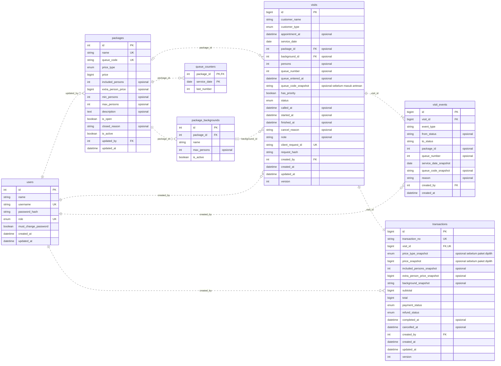
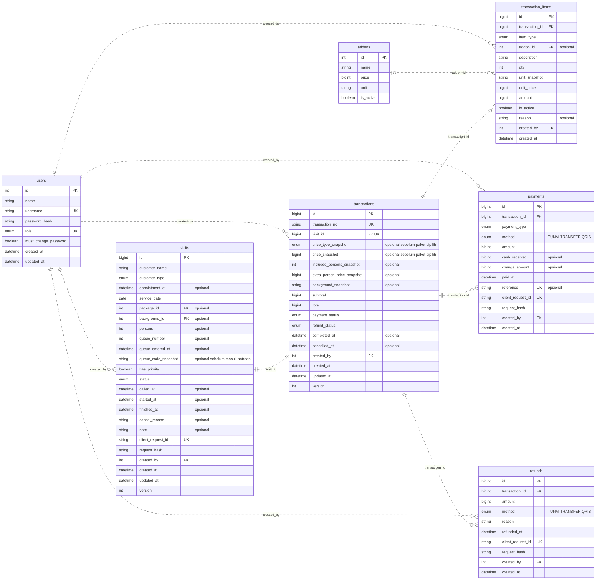

# ERD Dream Space Revisi 05

Disusun 11 November 2026 berdasarkan SRS_Dream_Space..docx, nomor SRS-DS-001 tanggal 10 November 2026. SRS §6 menyerahkan kolom dan tipe kepada Backend. Model ini memiliki 12 tabel bisnis yang disebut SRS dan dua tabel teknis, sessions serta queue_counters. Jumlah keseluruhan 14 tabel.

## Klarifikasi terbaru 11 November 2026

Tagihan yang sudah tercatat wajib lunas sebelum foto dimulai. Tambahan selama sesi (misalnya tambah waktu/cetak) boleh dibayar di akhir, dan seluruh tagihan wajib lunas sebelum SELESAI. Aturan ini mengikuti instruksi terbaru pengguna dan menggantikan ketentuan mulai sebelum lunas dalam SRS lama. Backend menyimpan audit START_PAYMENT_CHECK berisi total dan pembayaran bersih ketika mulai.

Implementasi menambahkan request_hash pada visits, payments, dan refunds untuk membandingkan payload retry. Tidak ada tabel bisnis baru. schema_migrations merupakan tabel pencatat migrasi di luar diagram utama.

## Perubahan dasar dari Revisi 03

| Sumber keputusan | Perubahan model |
| --- | --- |
| SRS §1.2 mengeluarkan promo dan voucher | Hapus promos, transactions.promo_id dan discount. Tagihan aktif sama dengan subtotal rincian aktif. |
| SRS §2.2 menetapkan dua akun tetap | users.role unik dengan nilai ADMIN atau OWNER. Seed dua akun sekali. Profil dan reset sandi Admin tetap tersedia. |
| SRS §2.4 menetapkan Tunai, Transfer, QRIS | payments.method dan refunds.method memakai enum tetap. Tabel payment_methods dihapus. |
| SRS §6 menyerahkan rancangan teknis ke Backend | sessions dan queue_counters dipertahankan untuk NFR-08 dan NFR-02. Kolom versi, idempotensi dan snapshot ditetapkan dalam dokumen ini. |
| SRS §4.3 aturan 17 menjaga harga transaksi lama | Transaksi menyimpan rumus dan tarif paket saat dipilih. Rincian menyimpan harga dan satuan. Koreksi/perubahan eksplisit tetap diaudit. |
| SRS §4.3 aturan 11 mengatur akhir hari | Penanganan sisa antrean dilakukan Admin. Sesi yang sudah berjalan tunduk pada larangan pembatalan setelah mulai foto, lihat konflik yang dicatat di bawah. |

## Keputusan teknis backend

- PK bertipe INT/BIGINT untuk ID, UUID sesi berupa CHAR(36), tanggal DATE dan waktu DATETIME(3) dengan konvensi WIB. Nominal memakai BIGINT Rupiah utuh. Implementasi Node menjaga nilai uang sebagai integer aman atau string desimal di batas JSON, dengan validasi rentang sebelum konversi.
- users mempunyai username unik dan role ENUM(ADMIN, OWNER) unik. Seed dua akun melalui skrip dengan kata sandi dari lingkungan lokal dan bcrypt. Role tetap. Audit mengidentifikasi akun bersama dan sesi, sehingga identitas karyawan individual tidak dapat dibuktikan dari log tersebut.
- sessions mencatat last_activity_at dan revoked_at. Logout, ganti sandi dan reset mencabut sesi yang terkait. JWT memuat ID sesi dan setiap request memeriksa sesi belum dicabut serta idle kurang dari 30 menit. Reset sandi Admin menetapkan must_change_password dan mengharuskan perubahan sebelum memakai fitur usaha.
- visits dan transactions dibuat bersama dalam transaksi DB. transactions.visit_id adalah FK wajib unik. Reservasi tanpa paket dapat memiliki transaksi dengan nol rincian, package_id/background_id/persons kosong. Sebelum masuk antrean, paket dan jumlah orang valid, latar wajib jika paket memiliki pilihan latar aktif.
- Paket/kunjungan berpindah hanya sebelum DIPANGGIL. Jika ganti paket saat MENUNGGU, simpan paket, nomor, tanggal dan kode lama dalam event, terbitkan nomor tujuan, dan pertahankan waktu masuk antrean serta ID transaksi. Snapshot kode menjaga nomor historis saat Owner mengubah kode paket. Counter monoton tidak diturunkan atau dipakai ulang.
- UNIQUE(package_id, service_date, queue_number) di visits dan PK(package_id, service_date) di queue_counters. Kunci baris counter saat menerbitkan nomor. Kunci baris paket saat mengalokasikan DIPANGGIL/SEDANG_DILAYANI. Semua endpoint yang mengubah alokasi memakai urutan penguncian konsisten. Jika melibatkan dua paket, kunci berdasarkan urutan ID.
- Prioritas ditentukan saat Admin mengonfirmasi reservasi. Keputusan teknis pemecah seri mengikuti rancangan sebelumnya, yakni jam janji, waktu masuk dan ID dalam kelompok prioritas, lalu waktu masuk dan ID untuk kelompok biasa. Admin boleh panggil di luar urutan dengan alasan. Pelanggan kembali dari DILEWATI kehilangan prioritas dan mendapat waktu masuk baru.
- package_addons menggunakan PK gabungan. Latar harus milik paket, ditegakkan melalui FK gabungan (background_id, package_id) ke pasangan unik (id, package_id) atau validasi atomik. Master yang direferensikan dinonaktifkan, penghapusan fisik dibatasi RESTRICT.
- Tarif yang sama pada transaksi lama memakai price_type_snapshot, price_snapshot, included_persons_snapshot dan extra_person_price_snapshot. Perubahan jumlah orang pada paket yang sama memakai tarif snapshot. Pergantian paket secara eksplisit menangkap tarif paket tujuan saat itu dan mengaudit nilai lama/baru. Tambahan baru menangkap harga master pada saat ditambahkan. Tambahan yang sudah ada mempertahankan unit_price saat qty berubah. Penggantian harga secara sengaja melalui koreksi harus terlacak.
- transaction_items menyimpan description, unit_snapshot, qty, unit_price dan amount = qty × unit_price. Rincian lama yang diganti dinonaktifkan, bukan dihapus. PAKET dan TAMBAH_ORANG tidak mengisi addon_id. TAMBAHAN wajib memakai addon yang diizinkan untuk paket tersebut. Latar disalin ke background_snapshot untuk cetak ulang nota.
- Total transaksi aktif = jumlah amount rincian aktif. Pembayaran bersih = SUM(payments.amount) − SUM(refunds.amount). Sisa = max(total − pembayaran bersih, 0), kelebihan = max(pembayaran bersih − total, 0). Tunai dipisahkan antara nominal diterapkan, uang diserahkan dan kembalian. Transfer/QRIS tidak boleh melebihi sisa saat tagihan sudah diketahui.
- Keputusan teknis untuk DP tanpa paket adalah menerima nominal positif yang sudah diverifikasi sebagai uang muka belum dialokasikan. Total sementara nol dan status BELUM_LUNAS jika saldo positif. Nilai itu belum diperlakukan sebagai kelebihan bayar sebelum paket dipilih. Setelah paket dipilih, saldo dihitung terhadap tagihan sebenarnya. Referensi unik diwajibkan pada DP nontunai. paid_at mempertahankan tanggal uang masuk, created_at waktu input.
- Mulai foto memerlukan pelunasan seluruh tagihan yang sudah tercatat. Tambahan yang terjadi setelah sesi mulai boleh menjadi sisa tagihan sementara dan dibayar pada akhir sesi. Konfirmasi akhir harus memuat jumlah orang dan seluruh tambahan terakhir. Selesai hanya ketika pembayaran bersih sama dengan total, termasuk tagihan nol. Saldo berlebih diselesaikan dulu melalui refund langsung Admin. Kunci transaksi saat seluruh pemeriksaan uang agar dua komputer tidak memakai saldo yang sama.
- Pembatalan sebelum foto menyimpan alasan serta cancelled_at, menetapkan total sebesar pembayaran bersih yang ditahan, dan mempertahankan rincian historis. Kasus tanpa pembayaran memiliki TIDAK_ADA_TAGIHAN. Pembatalan tidak membuat refund. Koreksi tidak membuka kembali status terminal atau membuat penerimaan kas fiktif.
- client_request_id unik pada visits/payments/refunds mencegah duplikasi pembuatan. Retry membandingkan payload bisnis terhadap data pertama, lalu mengembalikan hasil yang sama. Kunci sama dengan payload berbeda menghasilkan konflik. Status dan version diperiksa atomik saat panggil/mulai/selesai. Simpan audit bersama mutasi sehingga kegagalan membatalkan keduanya.
- audit_logs hanya append. entity memakai allowlist, entity_id string mendukung ID numerik maupun UUID. session_id optional untuk membedakan sesi komputer pada akun bersama. old_values/new_values punya schema per aksi, tidak menyimpan kata sandi/hash/token. Simpan alasan untuk pengecualian antrean, perubahan layanan, refund, penutupan ruang dan koreksi transaksi lunas.

## Enum dan nullable

| Kolom | Nilai atau kondisi |
| --- | --- |
| users.role | ADMIN, OWNER |
| packages.price_type dan snapshot | PER_SESI, PER_ORANG, PER_KELOMPOK |
| visits.customer_type | WALK_IN, RESERVASI |
| visits.status | RESERVASI, MENUNGGU, DIPANGGIL, SEDANG_DILAYANI, DILEWATI, SELESAI, DIBATALKAN |
| transactions.payment_status | BELUM_DIBAYAR, BELUM_LUNAS, LUNAS, KELEBIHAN_BAYAR, TIDAK_ADA_TAGIHAN |
| transactions.refund_status | BELUM_ADA, SEBAGIAN, PENUH |
| transaction_items.item_type | PAKET, TAMBAH_ORANG, TAMBAHAN |
| payments.payment_type | DP, PEMBAYARAN |
| payments.method dan refunds.method | TUNAI, TRANSFER, QRIS |

Kolom bertanda opsional dapat NULL. appointment_at wajib untuk RESERVASI. Tarif/orang tercakup snapshot boleh kosong sebelum pemilihan paket, kemudian mengikuti cara hitung. Batas jumlah orang NULL berarti tanpa batas yang ditetapkan Owner. from_status pada event pendaftaran boleh NULL. Master dan akun historis tetap disimpan. Setiap keputusan ini merupakan penurunan teknis SRS, bukan kutipan kamus data karena SRS terbaru tidak lagi memuat kamus kolom.

## Cakupan laporan dan batas yang masih terbuka

L-01 mengambil transaksi SELESAI berdasarkan completed_at. L-02 mengagregasi sesi dan nilai penjualan menurut paket, termasuk paket tanpa sesi pada periode terpilih. L-03 memakai paid_at dan refunded_at, serta memisahkan uang yang ditahan dari transaksi batal. L-04 memakai service_date kunjungan dan event historis. Nota dapat dicetak ulang setelah SELESAI menggunakan rincian snapshot dan pembayaran asal. Jadwal periode laporan mengikuti WIB. Semua laporan dan ekspor memeriksa role OWNER di API.

Aturan 11 menyebut seluruh kunjungan belum selesai dibatalkan saat tutup, sedangkan aturan 18 melarang pembatalan setelah foto mulai. Desain ini menjaga aturan 18. Admin menutup antrean yang belum mulai dengan alasan, sedangkan sesi berjalan harus diselesaikan melalui kasir. Jika studio memerlukan pengakhiran sesi berjalan tanpa lunas, mekanismenya perlu keputusan bisnis baru.

SRS tetap berasumsi satu paket mempunyai ruang sendiri. Dua paket berbagi ruang belum dapat diamankan dengan penguncian per paket. Sebelum produksi, pastikan asumsi tersebut atau tambahkan model sumber daya ruang bersama. Akun Admin bersama juga membatasi akuntabilitas sampai akun/sesi, sesuai keputusan pengguna SRS §2.2.

## Urutan mulai pekerjaan backend

1. Siapkan repositori dan Express dengan konfigurasi lingkungan, pemeriksaan kesehatan proses dan basis data, serta .gitignore.
2. Turunkan ERD ke migrasi MySQL. Uji FK, nomor unik, transaksi satu per kunjungan, lalu seed dua akun dengan kata sandi lokal.
3. Implementasikan login, pencabutan sesi, ganti sandi, reset Admin oleh Owner dan pemeriksaan role.
4. Implementasikan paket, latar dan tambahan beserta rumus harga. Uji snapshot tarif sebelum menghubungkan ke kasir.
5. Implementasikan reservasi/walk-in dan antrean per paket. Uji dua pendaftaran dan dua pemanggilan bersamaan.
6. Implementasikan DP, pembayaran, tambahan akhir, refund, pembatalan, koreksi dan nota. Uji retry dan saldo bersamaan.
7. Tambahkan dashboard/laporan/ekspor dari data sumber yang sama, lalu pengujian bersama frontend.

## Akun dan audit

## Paket dan layanan

## Kunjungan dan antrean

## Transaksi dan uang

Sumber [SRS tanggal 10 November 2026](<C:/Alul/Sistem Informasi UA24/Semester 5/MPSI/SRS_Dream_Space..docx>).
